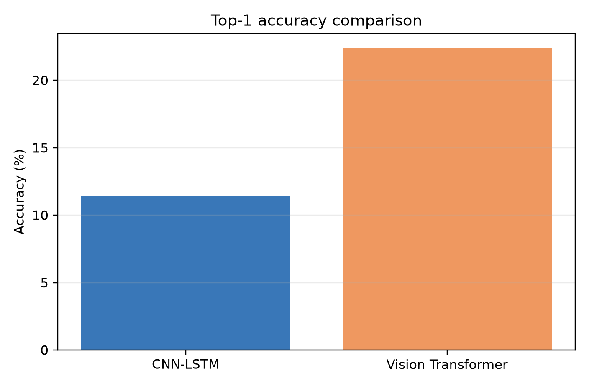
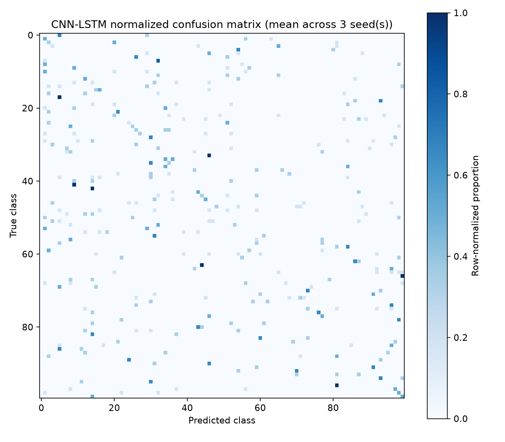
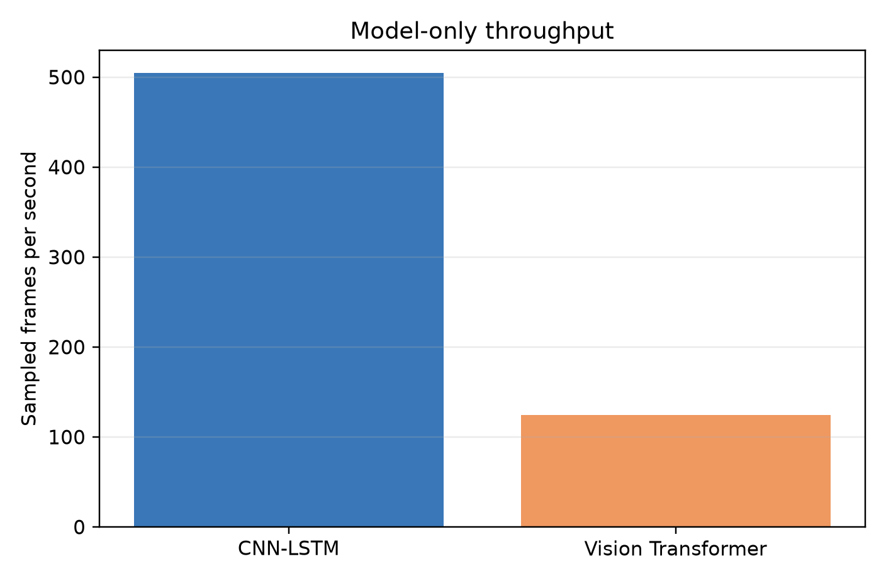
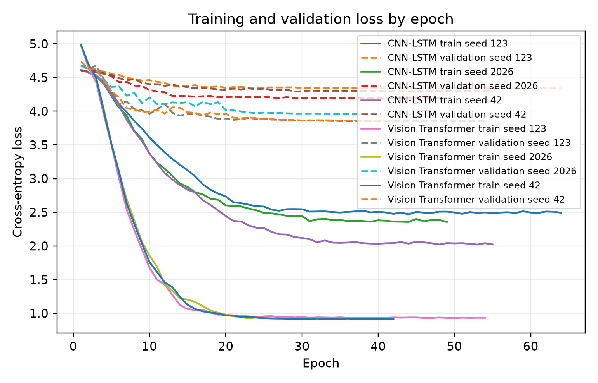
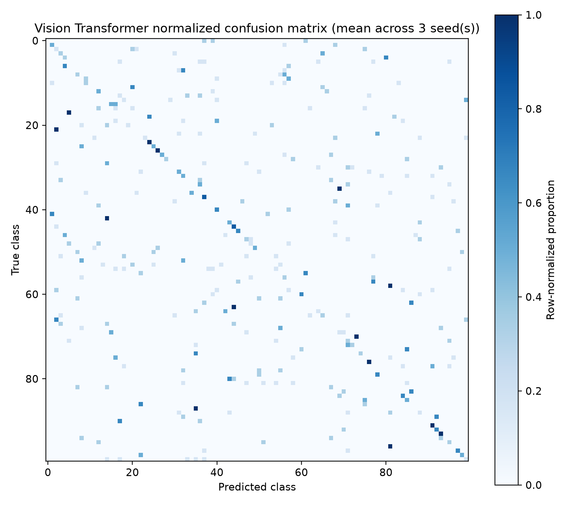

# A Comparative Study of CNN-LSTM and Vision Transformer Models for Real-Time Sign Language Recognition

## 1. Experimental Setup

- Dataset: WLASL-100
- Classes configured: 100
- Frames per clip: 16; image size: 224
- Configured split: stratified; seed(s): [42, 123, 2026]
- Training settings: epochs=150, batch size=8, learning rate=0.0003, pretrained=True
- Environment: {"platform": "Windows-11-10.0.26220-SP0", "machine": "AMD64", "processor": "AMD64 Family 25 Model 80 Stepping 0, AuthenticAMD", "cpu_count": 16, "memory_bytes": null, "hardware_model": null, "gpu": "NVIDIA GeForce RTX 3060 Laptop GPU", "accelerator": "cuda"}; software: {"python": "3.12.3", "Django": "5.2.18", "torch": "2.11.0+cu128", "torchvision": "0.26.0+cu128", "opencv-python-headless": "4.14.0", "numpy": "2.5.2", "pandas": "3.0.6", "scikit-learn": "1.9.1", "matplotlib": "3.11.2", "python-docx": "1.2.0", "scipy": "1.18.1"}

The saved experiment configuration is `experiment_config.json`. Each complete JSON record contains the actual split counts, test-video count, signer overlap, device, training duration, and model resource measurements.

## 2. Results

| Evaluation metric | CNN-LSTM | Vision Transformer | Better result |
|---|---:|---:|---|
| Top-1 accuracy (%) | 11.392 ± 1.266 (n=3) | 22.363 ± 2.396 (n=3) | Vision Transformer |
| Top-5 accuracy (%) | 27.426 ± 2.223 (n=3) | 49.367 ± 2.282 (n=3) | Vision Transformer |
| Macro precision (%) | 8.507 ± 1.362 (n=3) | 19.609 ± 2.918 (n=3) | Vision Transformer |
| Macro recall (%) | 10.333 ± 1.528 (n=3) | 21.333 ± 2.566 (n=3) | Vision Transformer |
| Macro F1-score (%) | 8.558 ± 0.921 (n=3) | 18.642 ± 2.360 (n=3) | Vision Transformer |
| Average inference latency (ms/clip) | 31.731 ± 1.076 (n=3) | 128.292 ± 0.650 (n=3) | CNN-LSTM |
| FPS (sampled frames/s) | 504.636 ± 17.396 (n=3) | 124.717 ± 0.632 (n=3) | CNN-LSTM |
| Model checkpoint size (MB) | 101.098 ± 0.001 (n=3) | 381.743 ± 0.000 (n=3) | CNN-LSTM |
| Training duration (s) | 16.024 ± 1.432 (n=3) | 24.545 ± 3.918 (n=3) | CNN-LSTM |

Completed runs: CNN-LSTM 3; Vision Transformer 3.

Metrics are means across successful seeds when there is more than one run; the accompanying `±` is sample standard deviation. A single run is preliminary and does not estimate run-to-run variability.

## 3. Comparative Analysis

The table reports measured values for both architectures. Per-metric direction is used for the ‘Better result’ column; these measurements do not establish a universal deployment winner. Latency and FPS here time the model forward pass on the recorded device and exclude video decoding and preprocessing.

## 4. Discussion

Differences may be associated with spatial feature extraction, temporal aggregation, model capacity, pretrained weights, and the dataset's signer and class distribution. These are possible explanations, not findings, unless supported by completed runs and the recorded protocol. The result files and training curves are the evidence for this implementation.

## 5. Hypothesis Evaluation

Multiple runs are available for both models. Mean and standard deviation are reported. No p-value is produced by this pipeline; a statistical test should only be added after checking paired seeds, distributional assumptions, and the selected unit of analysis.

## 6. Limitations

- Dataset availability, split integrity, class balance, and signer overlap must be verified from the recorded manifest and run metadata.
- Results are limited to the configured WLASL-100 data, preprocessing, architecture settings, seeds, and available hardware.
- The latency measure excludes decoding and preprocessing and should not be interpreted as end-to-end real-time performance.
- Statistical significance is not reported unless an appropriate analysis is separately implemented and justified.

## 7. Conclusion

No research conclusion can be drawn until both models complete evaluation on the shared held-out test split. This report intentionally leaves unavailable metrics as ‘Not measured’ and does not import published benchmark values into project results.

## Published literature (separate from project measurements)

No published benchmark numbers are included in this report. Add literature results only with their original citation, dataset, and evaluation conditions; they must remain distinct from these implementation measurements.

## Figures

*Figure: Accuracy Comparison generated from completed experiment records.*

*Figure: Cnn Lstm Confusion Matrix generated from completed experiment records.*

*Figure: F1 Comparison generated from completed experiment records.*

*Figure: Fps Comparison generated from completed experiment records.*

*Figure: Latency Comparison generated from completed experiment records.*

*Figure: Model Size Comparison generated from completed experiment records.*

*Figure: Training Curves generated from completed experiment records.*

*Figure: Validation Performance generated from completed experiment records.*

*Figure: Vision Transformer Confusion Matrix generated from completed experiment records.*

